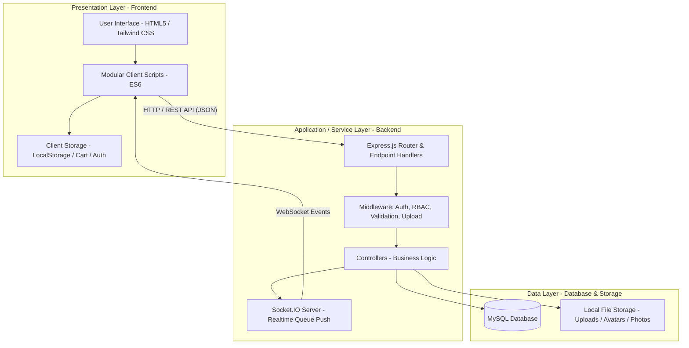
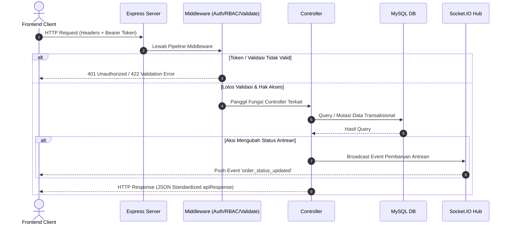

# Dokumen Perancangan Sistem: Arsitektur Backend & Frontend
**Kode WBS:** 2.1.1  
**Proyek:** KantinKu — Platform Pemesanan Makanan Kantin & UMKM Tanpa Antre  
**Status:** Selesai (Progress Tahap Perancangan)

---

## 1. Deskripsi Umum Arsitektur

KantinKu dirancang menggunakan pola **3-Tier Layered Client-Server Architecture** yang memisahkan tanggung jawab antara antarmuka pengguna (*Presentation Layer*), logika bisnis & pemrosesan (*Application/Business Layer*), dan penyimpanan data (*Data Layer*).



---

## 2. Perancangan Arsitektur Frontend

### 2.1 Karakteristik & Teknologi
- **Pendekatan:** Multi-Page Application (MPA) modular dengan komponen dinamis responsif.
- **Styling Engine:** Tailwind CSS (utility-first) terintegrasi dengan Google Material Symbols dan Tipografi Inter.
- **Client Communication:** Asynchronous fetch wrapper (`js/api.js`) yang mengelola JWT injection, deserialisasi JSON, dan penanganan error terpusat.
- **Client State:**
  - Kredensial pengguna & token tersimpan terenkripsi di `localStorage`.
  - Keranjang belanja (*shopping cart*) tersimpan di `localStorage` per warung/stall untuk mencegah tumpang tindih pesanan.

### 2.2 Struktur Modul Frontend
```
frontend/
├── index.html             # Katalog Kantin & UMKM Utama
├── menu.html              # Katalog Menu Warung & Modal Keranjang Belanja
├── stall.html             # Detail Profil Warung & Daftar Dagangan
├── orders.html            # Pelacak Antrean & Riwayat Pesanan
├── profile.html           # Manajemen Akun & Pengajuan Mitra
├── login.html             # Autentikasi Pengguna
├── register.html          # Pendaftaran Pembeli Baru
├── apply-umkm.html        # Formulir Pengajuan Lokasi UMKM Baru
├── apply-stall.html       # Formulir Pengajuan Warung Baru
├── seller/
│   └── dashboard.html     # Dashboard Operasional Penjual (Katalog, Antrean, Laporan)
├── admin/
│   └── dashboard.html     # Dashboard Admin (Review Mitra, Pengguna, Metrik)
└── js/
    ├── config.js          # Base URL & Environment Configuration
    ├── api.js             # API Client & Cart Persistence Engine
    ├── auth.js            # Controller Autentikasi Client
    ├── home.js            # Controller Halaman Utama
    ├── menu.js            # Controller Pemilihan Menu & Checkout
    ├── order.js           # Controller Pelacak Status Antrean
    ├── seller.js          # Controller Operasional Penjual
    └── admin.js           # Controller Panel Administrasi
```

---

## 3. Perancangan Arsitektur Backend

### 3.1 Karakteristik & Teknologi
- **Runtime:** Node.js (LTS).
- **Web Framework:** Express.js 4.x.
- **Realtime Layer:** Socket.IO untuk pembaruan nomor antrean dan status pesanan secara *push notification*.
- **Database Connector:** `mysql2/promise` dengan Connection Pooling untuk konkurensi tinggi.
- **Security & Integrity:** `bcryptjs` untuk hashing kata sandi dan `jsonwebtoken` (JWT) untuk *stateless token-based authorization*.

### 3.2 Diagram Alur Pemrosesan Request (Layered Backend)



### 3.3 Struktur Modul Backend
```
backend/
├── config/
│   ├── database.js        # Konfigurasi MySQL Pool Connection
│   └── socket.js          # Inisialisasi & Hub Socket.IO
├── middleware/
│   ├── authenticate.js    # Verifikasi Token JWT
│   ├── authorize.js       # Kontrol Akses Berbasis Role (RBAC)
│   ├── errorHandler.js    # Global Exception & Error Interceptor
│   ├── validate.js        # Validasi Skema Request (express-validator)
│   └── upload.js          # Manajemen Unggah Berkas & Gambar (Multer)
├── controllers/
│   ├── authController.js  # Manajemen Autentikasi & Akun
│   ├── umkmController.js  # Manajemen Entitas UMKM
│   ├── stallController.js # Manajemen Warung / Stall
│   ├── menuController.js  # Manajemen Item Menu & Stok
│   ├── orderController.js # Pemrosesan Transaksi & Pemecahan Split Order
│   ├── sellerQueueController.js # Pemrosesan Antrean Penjual
│   ├── sellerReportController.js# Agregasi Laporan Penjualan
│   ├── applicationController.js # Pengajuan Lokasi & Warung Baru
│   └── adminController.js # Approval & Administrasi Sistem
├── routes/
│   ├── authRoutes.js
│   ├── umkmRoutes.js
│   ├── stallRoutes.js
│   ├── menuRoutes.js
│   ├── orderRoutes.js
│   ├── sellerQueueRoutes.js
│   ├── sellerReportRoutes.js
│   ├── applicationRoutes.js
│   └── adminRoutes.js
├── database/
│   ├── schema.sql         # DDL Skema Relasional Database
│   ├── migrate.js         # Skrip Migrasi Struktur Database
│   └── seed.js            # Seeder Inisialisasi Akun Admin
├── utils/
│   ├── apiResponse.js     # Standarisasi Format Respons JSON
│   ├── generateCode.js    # Generator Kode Pickup 6-Digit
│   └── generateQueueNumber.js # Generator Nomor Antrean (A001, B001, dst)
└── server.js              # Entry Point Aplikasi Express & Socket.IO
```

---

## 4. Kesimpulan Perancangan Arsitektur

Pemisahan arsitektur yang tegas antara Frontend dan Backend menjamin:
1. **Skalabilitas:** Backend dapat diskalakan secara independen atau dihubungkan ke klien mobile di masa mendatang.
2. **Keamanan:** Kredensial tidak pernah terekspos langsung ke database, seluruh aksi dilindungi middleware autentikasi dan otorisasi role.
3. **Kinerja:** Pembaruan antrean berbasis WebSocket mengeliminasi beban *polling* berulang dari klien.
