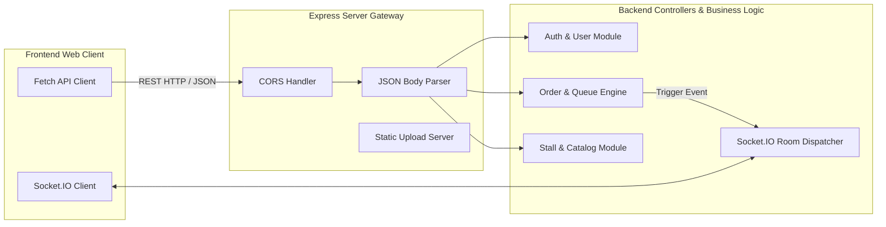

# Dokumen Perancangan Sistem: Integrasi Sistem & Spesifikasi API
**Kode WBS:** 2.1.2  
**Proyek:** KantinKu — Platform Pemesanan Makanan Kantin & UMKM Tanpa Antre  
**Status:** Selesai (Progress Tahap Perancangan)

---

## 1. Desain Integrasi Komunikasi Sistem

Integrasi antara Frontend dan Backend dibangun dengan protokol ganda:
1. **RESTful HTTP API:** Untuk operasi transaksional, CRUD data, otentikasi, dan pengajuan mitra dengan pertukaran data format JSON.
2. **WebSocket (Socket.IO):** Untuk transmisi real-time status antrean pesanan dari penjual ke pembeli secara instan tanpa *page refresh*.



---

## 2. Standarisasi Format Respons API

Seluruh endpoint backend mengimplementasikan format respons seragam menggunakan modul utilitas terpusat (`utils/apiResponse.js`):

### 2.1 Format Berhasil (Success Response)
```json
{
  "success": true,
  "message": "Deskripsi pesan status operasi",
  "data": { ... }
}
```

### 2.2 Format Gagal / Error (Error Response)
```json
{
  "success": false,
  "message": "Pesan kesalahan yang deskriptif",
  "errors": [ ... ]
}
```

---

## 3. Matriks Spesifikasi Endpoint API (REST Contract)

### 3.1 Modul Autentikasi (`/api/auth`)
| Method | Endpoint | Hak Akses | Deskripsi |
| :--- | :--- | :--- | :--- |
| `POST` | `/api/auth/register` | Public | Registrasi akun pembeli baru |
| `POST` | `/api/auth/login` | Public | Login pengguna & penerbitan token JWT |
| `POST` | `/api/auth/logout` | Public | Pembatalan sesi client |
| `GET` | `/api/auth/me` | Authenticated | Mengambil profil pengguna aktif |
| `PATCH`| `/api/auth/me` | Authenticated | Memperbarui nama, nomor telepon, dan foto avatar |
| `PATCH`| `/api/auth/me/password` | Authenticated | Memperbarui kata sandi pengguna |

### 3.2 Modul UMKM & Kantin (`/api/umkm`)
| Method | Endpoint | Hak Akses | Deskripsi |
| :--- | :--- | :--- | :--- |
| `GET` | `/api/umkm` | Public | Daftar kantin/UMKM aktif (filter kota & pencarian) |
| `GET` | `/api/umkm/:id` | Public | Detail UMKM beserta daftar warung terdaftar |

### 3.3 Modul Warung / Stall (`/api/stalls`)
| Method | Endpoint | Hak Akses | Deskripsi |
| :--- | :--- | :--- | :--- |
| `GET` | `/api/stalls/:id` | Public | Detail warung, kontak WhatsApp, dan jam operasional |
| `GET` | `/api/stalls/:id/menu` | Public | Daftar menu yang tersedia di warung tertentu |
| `GET` | `/api/stalls/:id/reviews` | Public | Ulasan dan rating bintang warung |

### 3.4 Modul Transaksi & Pesanan (`/api/orders`)
| Method | Endpoint | Hak Akses | Deskripsi |
| :--- | :--- | :--- | :--- |
| `POST` | `/api/orders` | Buyer | Checkout keranjang belanja (mendukung multi-warung/order-splitting) |
| `GET` | `/api/orders` | Buyer | Daftar seluruh pesanan aktif dan riwayat milik pembeli |
| `GET` | `/api/orders/:id` | Buyer | Detail spesifik transaksi dan pecahan split per warung |
| `GET` | `/api/orders/splits/:splitId/details` | Buyer | Detail item pesanan dan kode pengambilan (*pickup code*) |
| `POST` | `/api/ratings` | Buyer | Memberikan ulasan & rating bintang 1–5 untuk pesanan selesai |

### 3.5 Modul Operasional Penjual (`/api/seller`)
| Method | Endpoint | Hak Akses | Deskripsi |
| :--- | :--- | :--- | :--- |
| `GET` | `/api/seller/stall/my/profile` | Seller | Profil warung milik penjual yang login |
| `PATCH`| `/api/seller/stall/my/status` | Seller | Mengubah status buka / tutup warung |
| `GET` | `/api/seller/menu` | Seller | Katalog menu dagangan milik penjual |
| `POST` | `/api/seller/menu` | Seller | Menambahkan item menu baru |
| `PATCH`| `/api/seller/menu/:id` | Seller | Mengubah nama, harga, atau foto menu |
| `DELETE`| `/api/seller/menu/:id` | Seller | Menghapus menu dagangan |
| `GET` | `/api/seller/queue` | Seller | Daftar antrean pesanan pelanggan (Aktif / Riwayat) |
| `PATCH`| `/api/seller/queue/:id/status` | Seller | Memperbarui status antrean (*preparing / ready*) |
| `POST` | `/api/seller/queue/:id/verify` | Seller | Verifikasi kode pickup 6-digit untuk menyelesaikan pesanan |
| `GET` | `/api/seller/report` | Seller | Laporan penjualan berkala (Harian, Mingguan, Bulanan) |

### 3.6 Modul Administrasi (`/api/admin`)
| Method | Endpoint | Hak Akses | Deskripsi |
| :--- | :--- | :--- | :--- |
| `GET` | `/api/admin/stats` | Admin | Ringkasan statistik jumlah pengguna, UMKM, dan warung |
| `GET` | `/api/admin/metrics` | Admin | Metrik operasional platform dan total perputaran transaksi |
| `GET` | `/api/admin/applications/umkm` | Admin | Daftar pengajuan lokasi kantin/UMKM baru |
| `GET` | `/api/admin/applications/stall` | Admin | Daftar pengajuan pembukaan warung baru |
| `PATCH`| `/api/admin/applications/:id/review`| Admin | Persetujuan (*Approve*) atau penolakan (*Reject*) pengajuan |
| `GET` | `/api/admin/users` | Admin | Manajemen akun pengguna terdaftar |
| `PATCH`| `/api/admin/users/:id/role` | Admin | Mengubah wewenang/role pengguna |

---

## 4. Perancangan Kontrak Real-Time (Socket.IO Events)

Integrasi WebSocket menghubungkan antrean real-time antara penjual dan pembeli:

| Nama Event | Pengirim | Penerima | Payload Data | Keterangan |
| :--- | :--- | :--- | :--- | :--- |
| `join_order_room` | Client Pembeli | Server Socket | `{ orderId: string }` | Klien bergabung ke *room* pesanan pribadinya |
| `join_stall_room` | Client Penjual | Server Socket | `{ stallId: string }` | Penjual bergabung ke *room* warung miliknya |
| `new_order_received` | Server | Penjual | `{ splitId, queueNumber, items, total }` | Notifikasi instan pesanan masuk ke penjual |
| `order_status_changed` | Server | Pembeli | `{ splitId, status, queueNumber }` | Update progres (*Antrean ➜ Dimasak ➜ Siap*) ke pembeli |
