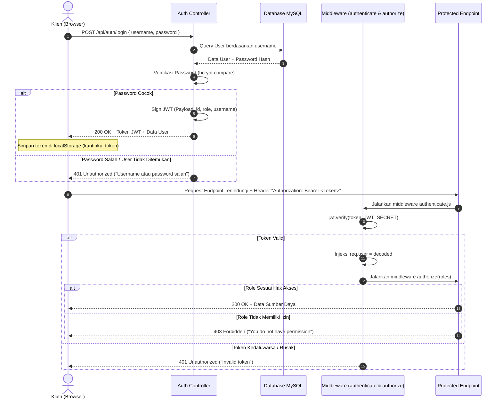

# Dokumen Perancangan Sistem: Mekanisme Autentikasi & Role-Based Access Control (RBAC)
**Kode WBS:** 2.1.3  
**Proyek:** KantinKu — Platform Pemesanan Makanan Kantin & UMKM Tanpa Antre  
**Status:** Selesai (Progress Tahap Perancangan)

---

## 1. Mekanisme Autentikasi Berbasis JWT (JSON Web Token)

KantinKu menerapkan sistem otentikasi **Stateless Token-Based Authentication** menggunakan standar RFC 7519 (JSON Web Token). Mekanisme ini menjamin keamanan komunikasi tanpa memerlukan penyimpanan sesi (*session store*) di server, sehingga sistem sangat skalabel dan tangguh.



---

## 2. Struktur Token & Keamanan Kredensial

### 2.1 Komposisi Payload JWT
Payload token yang diterbitkan memuat informasi identitas minimal untuk menghindari pembengkakan ukuran header:
```json
{
  "id": "e2a1b942-88ef-4ef5-9f5e-18e472a1290a",
  "username": "adrian",
  "role": "buyer",
  "iat": 1729900000,
  "exp": 1730504800
}
```

### 2.2 Kebijakan Kata Sandi (Password Hashing)
- Kata sandi mentah (*plain-text*) tidak pernah disimpan ke dalam database.
- Algoritma hashing menggunakan **Bcrypt** dengan salt factor bernilai `10`.
- Setiap kata sandi melalui pengacakan satu arah (*one-way cryptographic hash*) yang tahan terhadap serangan *rainbow tables*.

---

## 3. Matriks Kontrol Akses Berbasis Peran (RBAC Matrix)

KantinKu mendefinisikan 3 level hak akses utama:
1. **Buyer (Pembeli):** Pengguna akhir yang mencari kantin, memesan makanan, melacak antrean, dan memberikan ulasan.
2. **Seller (Penjual / Pemilik Warung):** Pengelola stan makanan yang mengatur menu, menerima pesanan, memperbarui status antrean, dan memvalidasi pengambilan.
3. **Admin (Administrator Platform):** Pengelola platform yang menyetujui pengajuan kemitraan UMKM/Warung, memonitor metrik, dan mengatur status pengguna.

| Fitur / Modul Sistem | Publik (Guest) | Pembeli (Buyer) | Penjual (Seller) | Admin Platform |
| :--- | :---: | :---: | :---: | :---: |
| Lihat Daftar Kantin & Menu | ✅ Ya | ✅ Ya | ✅ Ya | ✅ Ya |
| Registrasi Akun Pembeli | ✅ Ya | ❌ Tidak | ❌ Tidak | ❌ Tidak |
| Login ke Sistem | ✅ Ya | ✅ Ya | ✅ Ya | ✅ Ya |
| Tambah ke Keranjang Belanja | ❌ Tidak | ✅ Ya | ❌ Tidak | ❌ Tidak |
| Checkout & Terbitkan Antrean | ❌ Tidak | ✅ Ya | ❌ Tidak | ❌ Tidak |
| Lihat Riwayat & Pesanan Saya | ❌ Tidak | ✅ Ya | ❌ Tidak | ❌ Tidak |
| Beri Rating & Ulasan Makanan | ❌ Tidak | ✅ Ya | ❌ Tidak | ❌ Tidak |
| Ajukan UMKM / Warung Baru | ❌ Tidak | ✅ Ya | ✅ Ya | ❌ Tidak |
| Buka / Tutup Status Warung | ❌ Tidak | ❌ Tidak | ✅ Ya | ❌ Tidak |
| Kelola Menu Dagangan Sendiri | ❌ Tidak | ❌ Tidak | ✅ Ya | ❌ Tidak |
| Proses Antrean & Verifikasi Kode | ❌ Tidak | ❌ Tidak | ✅ Ya | ❌ Tidak |
| Lihat Laporan Penjualan Warung | ❌ Tidak | ❌ Tidak | ✅ Ya | ❌ Tidak |
| Review Pengajuan UMKM & Warung | ❌ Tidak | ❌ Tidak | ❌ Tidak | ✅ Ya |
| Kelola Status UMKM & Warung | ❌ Tidak | ❌ Tidak | ❌ Tidak | ✅ Ya |
| Kelola Role & Akun Pengguna | ❌ Tidak | ❌ Tidak | ❌ Tidak | ✅ Ya |
| Lihat Metrik & Pendapatan Global | ❌ Tidak | ❌ Tidak | ❌ Tidak | ✅ Ya |

---

## 4. Implementasi Middleware Backend

### 4.1 Middleware Verifikasi Token (`backend/middleware/authenticate.js`)
Memeriksa keberadaan header HTTP `Authorization: Bearer <token>`, memverifikasi keaslian tanda tangan token dengan kunci rahasia (`JWT_SECRET`), dan menginjeksikan objek `req.user` untuk handler selanjutnya.

### 4.2 Middleware Otorisasi Role (`backend/middleware/authorize.js`)
Menguji apakah role `req.user.role` terdaftar dalam daftar parameter peran yang diperbolehkan. Jika tidak sesuai, request langsung ditolak dengan status kode `403 Forbidden`.

```javascript
// Contoh Penerapan Otorisasi pada Route:
router.patch('/queue/:id/status', authenticate, authorize('seller'), sellerQueueController.updateStatus);
router.patch('/users/:id/role', authenticate, authorize('admin'), adminController.updateUserRole);
```

---

## 5. Proteksi Sisi Klien (Frontend Route Guards)

Di sisi Frontend, fungsi utilitas `requireAuth(allowedRoles)` pada `js/api.js` dieksekusi saat halaman dimuat:
- Jika token tidak ditemukan: Klien diarahkan secara otomatis ke `login.html`.
- Jika peran pengguna tidak memenuhi `allowedRoles`: Klien ditampilkan pesan kesalahan dan dialihkan ke beranda yang diizinkan.
