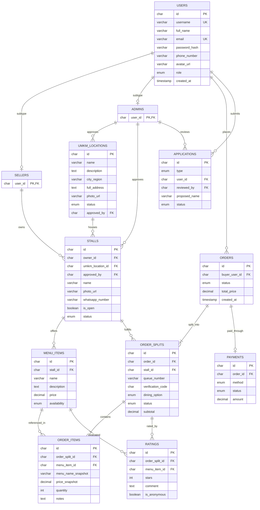

# Dokumen Perancangan Sistem: Perancangan Database & Kamus Data
**Kode WBS:** 2.2  
**Proyek:** KantinKu — Platform Pemesanan Makanan Kantin & UMKM Tanpa Antre  
**Status:** Selesai (Progress Tahap Perancangan)

---

## 1. Ikhtisar Perancangan Database

Database KantinKu dirancang menggunakan basis data relasional **MySQL 8.0** dengan engine **InnoDB** yang mendukung penuh transaksi ACID, integritas referensial *Foreign Key*, serta pengindeksan performa tinggi.

Perancangan skema menggunakan pendekatan pemodelan tingkat lanjut:
1. **Supertype/Subtype Pattern:** Tabel induk `USERS` dengan turunan `SELLERS` dan `ADMINS`.
2. **Order-Splitting Pattern:** Transaksi tunggal pelanggan (`ORDERS`) dipecah secara otomatis menjadi sub-antrean (`ORDER_SPLITS`) per masing-masing stan/warung tujuan, memungkinkan satu kali checkout untuk makanan dari berbagai warung berbeda.
3. **Single Table Inheritance:** Tabel `APPLICATIONS` menampung pengajuan pembukaan lokasi UMKM maupun pembukaan stan warung baru.

---

## 2. Diagram Hubungan Entitas (Entity-Relationship Diagram / ERD)

---

## 3. Kamus Data (Data Dictionary)

### 3.1 Tabel `USERS` (Tabel Induk Akun Pengguna)
| Nama Kolom | Tipe Data | Constraint | Keterangan |
| :--- | :--- | :--- | :--- |
| `id` | CHAR(36) | Primary Key | UUID v4 identitas unik pengguna |
| `username` | VARCHAR(255) | Unique, Not Null | Username tanpa spasi |
| `full_name` | VARCHAR(255) | Not Null | Nama lengkap pengguna |
| `email` | VARCHAR(255) | Unique, Not Null | Alamat surat elektronik terverifikasi |
| `password_hash` | VARCHAR(255) | Not Null | Hash kata sandi menggunakan bcrypt |
| `phone_number` | VARCHAR(20) | Nullable | Nomor WhatsApp / kontak telepon |
| `avatar_url` | VARCHAR(255) | Nullable | Tautan berkas foto profil pengguna |
| `role` | ENUM('buyer','seller','admin') | Not Null, Default 'buyer' | Peran pengguna dalam ekosistem |
| `created_at` | TIMESTAMP | Default CURRENT_TIMESTAMP | Waktu pendaftaran |
| `updated_at` | TIMESTAMP | Auto Update | Waktu pembaruan terakhir |

### 3.2 Tabel `SELLERS` & `ADMINS` (Subtype Users)
- **`SELLERS`:** Memiliki kolom `user_id CHAR(36) PK/FK` merujuk ke `USERS(id)` ON DELETE CASCADE.
- **`ADMINS`:** Memiliki kolom `user_id CHAR(36) PK/FK` merujuk ke `USERS(id)` ON DELETE CASCADE.

### 3.3 Tabel `UMKM_LOCATIONS` (Lokasi / Pusat Kantin Kampus)
| Nama Kolom | Tipe Data | Constraint | Keterangan |
| :--- | :--- | :--- | :--- |
| `id` | CHAR(36) | Primary Key | UUID v4 lokasi kantin |
| `name` | VARCHAR(255) | Not Null | Nama kantin / sentra kuliner |
| `description` | TEXT | Nullable | Ulasan fasilitas kantin |
| `city_region` | VARCHAR(255) | Not Null | Kota/wilayah (e.g. Jakarta, Bandung) |
| `full_address` | TEXT | Not Null | Alamat fisik lengkap lokasi |
| `photo_url` | VARCHAR(255) | Nullable | Foto banner lokasi |
| `status` | ENUM | Not Null | Status lokasi: pending, approved, rejected, suspended |
| `approved_by` | CHAR(36) | FK -> ADMINS(user_id) | Admin yang menyetujui |

### 3.4 Tabel `STALLS` (Warung / Mitra Stan Makanan)
| Nama Kolom | Tipe Data | Constraint | Keterangan |
| :--- | :--- | :--- | :--- |
| `id` | CHAR(36) | Primary Key | UUID v4 warung |
| `owner_id` | CHAR(36) | FK -> SELLERS(user_id) | Pemilik warung |
| `umkm_location_id` | CHAR(36) | FK -> UMKM_LOCATIONS(id) | Lokasi kantin tempat warung berada |
| `name` | VARCHAR(255) | Not Null | Nama warung / toko |
| `photo_url` | VARCHAR(255) | Nullable | Foto gerai warung |
| `whatsapp_number` | VARCHAR(20) | Not Null | Nomor WhatsApp penjual untuk konfirmasi |
| `is_open` | BOOLEAN | Default TRUE | Saklar status buka/tutup warung |
| `status` | ENUM | Not Null | Status kurasi: pending, approved, rejected |

### 3.5 Tabel `MENU_ITEMS` (Katalog Menu Makanan & Minuman)
| Nama Kolom | Tipe Data | Constraint | Keterangan |
| :--- | :--- | :--- | :--- |
| `id` | CHAR(36) | Primary Key | UUID v4 menu |
| `stall_id` | CHAR(36) | FK -> STALLS(id) | Warung penyedia menu |
| `name` | VARCHAR(255) | Not Null | Nama hidangan |
| `price` | DECIMAL(10,2) | Not Null | Harga satuan (IDR) |
| `availability` | ENUM('available','unavailable') | Default 'available' | Ketersediaan stok menu |

### 3.6 Tabel `ORDERS`, `ORDER_SPLITS`, dan `ORDER_ITEMS`
- **`ORDERS`:** Menampung total transaksi checkout pembeli (`buyer_user_id`, `total_price`, `status`).
- **`ORDER_SPLITS`:** Pecahan sub-transaksi per warung untuk antrean independen:
  - `queue_number`: Nomor urut antrean harian warung (format: `A001`, `B002`).
  - `verification_code`: Kode verifikasi 6-digit untuk validasi pengambilan pesanan.
  - `dining_option`: `dine_in` (Makan di Tempat) atau `takeaway` (Bungkus).
  - `status`: `pending` (Antrean), `preparing` (Dimasak), `ready` (Siap Diambil), `completed` (Selesai).
- **`ORDER_ITEMS`:** Snapshot item makanan (`menu_name_snapshot`, `price_snapshot`, `quantity`, `notes`) sehingga data riwayat tidak terpengaruh jika harga menu berubah di kemudian hari.

---

## 4. Kebijakan Seeding Data Tahap Perancangan (WBS 2.2)

Sesuai dengan ketentuan ruang lingkup **WBS 2.2 Perancangan Database**:
- Struktur skema DDL (`schema.sql`) dan skrip pembuat database (`migrate.js`) telah selesai dirancang dan divalidasi.
- **Tidak ada populasi data dummy** untuk transaksi, UMKM, warung, maupun menu makanan pada tahap ini.
- **Satu-satunya akun yang diinisialisasi (*seeded*) adalah akun Administrator (`admin`)**, karena keberadaan akun admin wajib diperlukan sebagai entitas dasar untuk kurasi pengajuan dan inisialisasi awal sistem:
  - **Username:** `admin`
  - **Password:** `password123` (tersimpan dalam bentuk *bcrypt hash*)
  - **Email:** `admin@kantinku.com`
  - **Role:** `admin` (tercatat di tabel `USERS` dan `ADMINS`)
