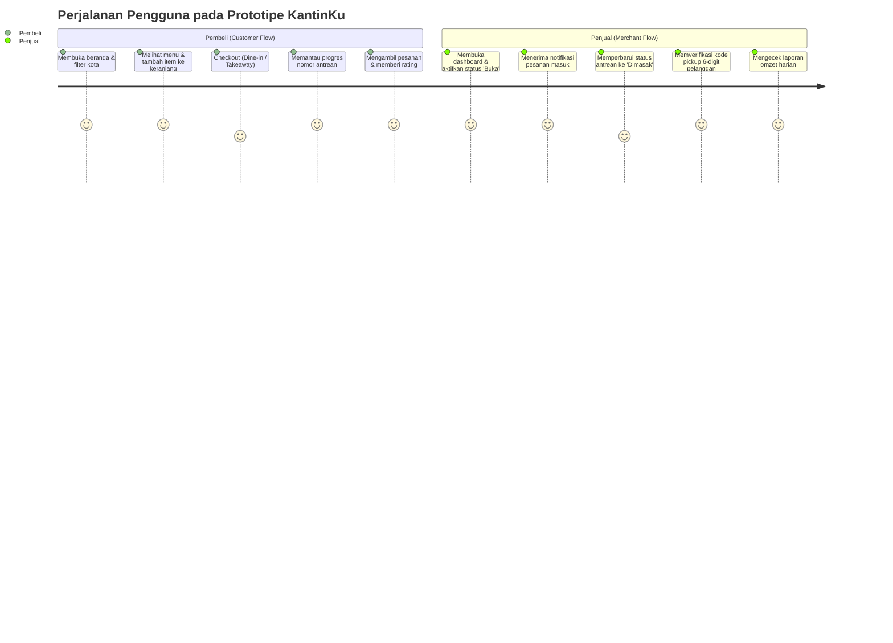

# Dokumen Perancangan Sistem: Perancangan UI/UX & Prototipe Antarmuka
**Kode WBS:** 2.3  
**Proyek:** KantinKu — Platform Pemesanan Makanan Kantin & UMKM Tanpa Antre  
**Status:** Selesai (Menggunakan Prototipe Interaktif yang Telah Dibangun)

---

## 1. Status Capaian WBS 2.3

Tahap **WBS 2.3 Perancangan UI/UX** telah selesai secara menyeluruh. Seluruh perancangan antarmuka telah direalisasikan ke dalam bentuk **Prototipe Interaktif Berbasis Web** yang dapat diuji coba secara langsung pada folder induk:  
📂 [`prototype/`](../index.html)

Prototipe ini merepresentasikan 100% desain antarmuka, tata letak, komponen grafis, dan skenario interaksi pengguna yang sesungguhnya.

---

## 2. Desain Sistem (Design System Guidelines)

### 2.1 Palet Warna Resmi (Color Tokens)
Menggunakan standar Material Design 3 yang dioptimalkan untuk tema kuliner modern:

```
Primary (Terracotta / Oranye Hangat):  #ab3500  (Brand utama, aksen tombol, badge antrean)
Primary Container:                     #ff6b35  (Sorotan interaktif)
Secondary (Navy Blue):                 #24619d  (Navigasi & elemen sekunder)
Tertiary (Emerald Green):              #006d3e  (Status berhasil, 'Buka', konfirmasi)
Error (Deep Red):                      #ba1a1a  (Status dibatalkan, pesan kesalahan)
Background:                            #f7f9fc  (Latar belakang canvas aplikasi)
Surface:                               #ffffff  (Permukaan kartu konten & modal)
Outline / Border:                      #e0e3e6  (Garis pembatas halus)
```

### 2.2 Tipografi & Ikonografi
- **Font Family:** `Inter`, sans-serif (Google Fonts) dengan variasi bobot `400` (Regular), `500` (Medium), `600` (SemiBold), dan `700` (Bold).
- **Icon Set:** `Material Symbols Outlined` (Google Fonts) dengan variasi fill dinamis untuk status aktif.

---

## 3. Direktori Halaman & Tautan Akses Prototipe

Seluruh halaman prototipe dapat diakses secara langsung:

| Role Pengguna | Halaman Antarmuka | Berkas Prototipe | Deskripsi Interaksi |
| :--- | :--- | :--- | :--- |
| **Pembeli** | Katalog Kantin | [`index.html`](../index.html) | Pencarian UMKM real-time, filter kota, grid kartu responsif |
| **Pembeli** | Menu & Keranjang | [`menu.html`](../menu.html?umkmId=umkm-1) | Pemilihan menu, penambahan keranjang, modal checkout, ulasan |
| **Pembeli** | Detail Warung | [`stall.html`](../stall.html?id=stl-1) | Profil stan warung spesifik dan daftar dagangan |
| **Pembeli** | Pelacak Antrean | [`orders.html`](../orders.html) | Stepper progress status (*Antrean ➜ Dimasak ➜ Siap*), rating bintang |
| **Pembeli** | Profil & Mitra | [`profile.html`](../profile.html) | Edit profil, ganti password, pengajuan UMKM/Warung |
| **Penjual** | Dashboard Penjual | [`seller/dashboard.html`](../seller/dashboard.html) | Saklar status buka/tutup, antrean real-time, katalog menu, laporan |
| **Admin** | Dashboard Admin | [`admin/dashboard.html`](../admin/dashboard.html) | Ringkasan metrik platform, review & approval pengajuan, manajemen user |
| **Publik** | Halaman Masuk | [`login.html`](../login.html) | Formulir login dengan tombol pintas demo (*Buyer / Seller / Admin*) |
| **Publik** | Halaman Daftar | [`register.html`](../register.html) | Formulir pendaftaran akun pembeli baru |

---

## 4. Alur Interaksi Pengguna (User Journey Highlights)



---

## 5. Kesimpulan WBS 2.3

Dengan tersedianya prototipe interaktif yang telah divalidasi pada folder `prototype/`, seluruh kebutuhan perancangan antarmuka, tata letak, dan pengalaman pengguna (UI/UX) dinyatakan **telah selesai 100%** dan siap dihubungkan pada tahap implementasi sistem berikutnya.
