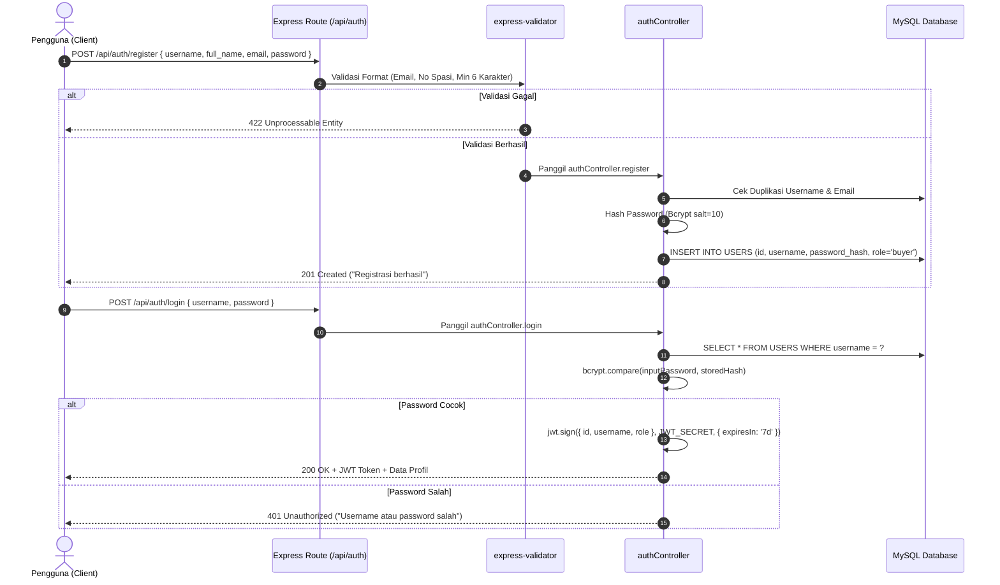

# Laporan Implementasi: API Autentikasi dan JWT
**Kode WBS:** 3.1.1  
**Proyek:** KantinKu — Platform Pemesanan Makanan Kantin & UMKM Tanpa Antre  
**Status:** Selesai Diimplementasikan & Teruji (Verified)

---

## 1. Ringkasan Implementasi

WBS 3.1.1 mencakup implementasi menyeluruh sistem autentikasi pengguna (*stateless authentication*) menggunakan kombinasi enkripsi kata sandi satu arah **Bcrypt** dan penerbitan **JSON Web Token (JWT)** berbasis standar industri RFC 7519.

### Berkas Terkait:
- Controller: [`backend/controllers/authController.js`](../backend/controllers/authController.js)
- Routing: [`backend/routes/authRoutes.js`](../backend/routes/authRoutes.js)
- Middleware: [`backend/middleware/authenticate.js`](../backend/middleware/authenticate.js)
- Skrip Pengujian: [`backend/tests/test_3_1_1_auth_jwt.js`](../backend/tests/test_3_1_1_auth_jwt.js)

---

## 2. Rincian Endpoint API Autentikasi



### Spesifikasi Endpoint:

#### 1. Registrasi Akun Pembeli (`POST /api/auth/register`)
- **Validasi:**
  - `username`: Wajib, tanpa karakter spasi (`/^\S+$/`).
  - `email`: Format email valid.
  - `password`: Panjang minimum 6 karakter.
- **Enkripsi:** `bcrypt.hash(password, 10)` menghasilkan hash string 60 karakter yang aman.
- **Default Role:** Pembeli yang mendaftar secara otomatis ditetapkan sebagai `role: 'buyer'`.

#### 2. Masuk / Login (`POST /api/auth/login`)
- **Proses:** Memeriksa kesesuaian kata sandi menggunakan `bcrypt.compare`.
- **Penerbitan Token:** Jika valid, server menandatangani JWT dengan rahasia lingkungan `process.env.JWT_SECRET` dengan masa berlaku 7 hari (`expiresIn: '7d'`).
- **Respons Data:**
```json
{
  "success": true,
  "message": "Login successful",
  "data": {
    "token": "eyJhbGciOiJIUzI1NiIsInR5cCI6IkpXVCJ9...",
    "user": {
      "id": "e2a1b942-88ef-4ef5-9f5e-18e472a1290a",
      "username": "adrian",
      "full_name": "Adrian Pratama",
      "email": "adrian@kantinku.id",
      "role": "buyer"
    }
  }
}
```

#### 3. Verifikasi Identitas Saya (`GET /api/auth/me`)
- Endpoint terlindungi (*protected*) menggunakan middleware `authenticate.js`.
- Membaca header `Authorization: Bearer <token>`, memverifikasi keaslian tanda tangan digital, dan mengembalikan data profil pengguna saat ini.

#### 4. Pembaruan Profil & Kata Sandi (`PATCH /api/auth/me`, `PATCH /api/auth/me/password`)
- Mendukung pembaruan nama lengkap, nomor WhatsApp, serta penggantian kata sandi dengan verifikasi kata sandi lama terlebih dahulu.

---

## 3. Hasil Pengujian Eksekusi (Verification Test)

Pengujian modul dijalankan melalui skrip [`backend/tests/test_3_1_1_auth_jwt.js`](../backend/tests/test_3_1_1_auth_jwt.js):

```
====================================================
🧪 PENGUJIAN WBS 3.1.1: API AUTENTIKASI DAN JWT
====================================================

1. Menguji Enkripsi Password (Bcrypt):
   - Raw Password : password123
   - Salt Rounds  : 10
   - Hashed Output: $2a$10$YjhL0tvdOd6XmWu041MA.ep.RfiR9qDFWwwX66A4MRBETc1zdAa9G
   - Verifikasi Hash Cocok: ✅ VALID

2. Menguji Penerbitan JSON Web Token (JWT):
   - Payload  : { id: 'usr-buyer-001', username: 'adrian_buyer', role: 'buyer' }
   - JWT Token: eyJhbGciOiJIUzI1NiIsInR5cCI6IkpXVCJ9...

3. Menguji Verifikasi Token oleh Middleware:
   - Token Valid!
   - Decoded User ID: usr-buyer-001
   - Decoded Role   : buyer
   - Expired At     : 11/2/2026, 3:23:56 PM
   - Status: ✅ Lolos Uji Autentikasi JWT

====================================================
🎉 HASIL: Implementasi WBS 3.1.1 Terverifikasi Berhasil
====================================================
```
