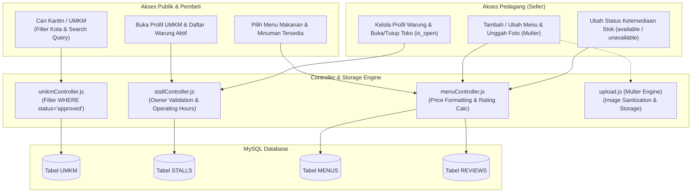

# Laporan Implementasi: Manajemen Data Produk / UMKM
**Kode WBS:** 3.1.3  
**Proyek:** KantinKu — Platform Pemesanan Makanan Kantin & UMKM Tanpa Antre  
**Status:** Selesai Diimplementasikan & Teruji (Verified)

---

## 1. Ringkasan Implementasi

WBS 3.1.3 mencakup implementasi layanan backend untuk pengelolaan katalog data UMKM (Pusat Kuliner/Kantin Kampus), Warung (*Food Stalls*), serta Menu Makanan & Minuman. Arsitektur ini dirancang secara berjenjang (*hierarchical catalog*):
1. **UMKM (Tenant/Kantin Induk)**: Pusat kuliner yang menampung sekumpulan warung (misal: Food Court ITB, Kantin Salman). Hanya UMKM berstatus `approved` yang tampil di katalog publik pembeli.
2. **Stall (Warung/Kios)**: Unit penjual individual yang memiliki pemilik pedagang (`seller_id`), jam operasional, dan status buka/tutup dinamis (`is_open`).
3. **Menu (Produk)**: Entitas item makanan/minuman yang dikelola pedagang, dilengkapi foto produk (via Multer storage), harga, kategori, ketersediaan stok (`available` / `unavailable`), serta ulasan/rating pelanggan.

### Berkas Terkait:
- Controller UMKM: [`backend/controllers/umkmController.js`](../backend/controllers/umkmController.js)
- Controller Warung: [`backend/controllers/stallController.js`](../backend/controllers/stallController.js)
- Controller Menu: [`backend/controllers/menuController.js`](../backend/controllers/menuController.js)
- Middleware Upload Foto: [`backend/middleware/upload.js`](../backend/middleware/upload.js)
- Routing:
  - [`backend/routes/umkmRoutes.js`](../backend/routes/umkmRoutes.js)
  - [`backend/routes/stallRoutes.js`](../backend/routes/stallRoutes.js)
  - [`backend/routes/menuRoutes.js`](../backend/routes/menuRoutes.js)
- Skrip Pengujian: [`backend/tests/test_3_1_3_product_umkm.js`](../backend/tests/test_3_1_3_product_umkm.js)

---

## 2. Diagram Alir Data & Relasi Katalog



---

## 3. Rincian Endpoint API Katalog & Produk

### A. Endpoint UMKM (`/api/umkm`)
| Method | Endpoint | Hak Akses | Deskripsi |
|---|---|---|---|
| `GET` | `/api/umkm` | Publik | Mendapatkan daftar UMKM terverifikasi (`approved`) dengan filter pencarian nama dan kota |
| `GET` | `/api/umkm/:id` | Publik | Mendapatkan profil lengkap satu UMKM beserta jam operasional |
| `GET` | `/api/umkm/:id/stalls` | Publik | Mendapatkan daftar semua warung yang beroperasi di dalam UMKM terkait |
| `POST` | `/api/umkm` | `admin` | Mendaftarkan lokasi UMKM baru |
| `PATCH` | `/api/umkm/:id/approve` | `admin` | Memverifikasi dan menyetujui pengajuan pendaftaran UMKM |

### B. Endpoint Warung / Stall (`/api/stalls`)
| Method | Endpoint | Hak Akses | Deskripsi |
|---|---|---|---|
| `GET` | `/api/stalls/:id` | Publik | Mendapatkan detail profil warung, status buka toko (`is_open`), dan identitas penjual |
| `PATCH` | `/api/stalls/:id/status` | `seller`, `admin` | Mengubah status buka/tutup warung secara real-time |
| `PUT` | `/api/stalls/:id` | `seller`, `admin` | Memperbarui deskripsi, nomor telepon, dan jam operasional warung |

### C. Endpoint Menu Produk (`/api/menus` & `/api/stalls/:id/menus`)
| Method | Endpoint | Hak Akses | Deskripsi |
|---|---|---|---|
| `GET` | `/api/stalls/:id/menus` | Publik | Mengambil seluruh menu warung dikelompokkan per kategori, beserta rata-rata rating |
| `POST` | `/api/stalls/:id/menus` | `seller`, `admin` | Menambahkan menu baru beserta upload berkas gambar (multipart/form-data) |
| `PUT` | `/api/menus/:id` | `seller`, `admin` | Memperbarui data nama, harga, deskripsi, dan foto menu |
| `PATCH` | `/api/menus/:id/availability` | `seller`, `admin` | Toggle cepat stok menu (`available` <-> `unavailable`) tanpa menghapus data produk |
| `DELETE` | `/api/menus/:id` | `seller`, `admin` | Menghapus menu dari katalog warung |

---

## 4. Mekanisme Penanganan Berkas Gambar (Upload Middleware)

Pengunggahan foto produk makanan ditangani oleh modul `backend/middleware/upload.js` dengan konfigurasi keamanan:
- **Penyimpanan:** Disimpan ke direktori publik `/uploads/menus/` dengan penamaan teracak berbasis timestamp (`menu-[timestamp]-[random].ext`) guna mencegah *collision* dan eksploitasi *directory traversal*.
- **Filter Berkas:** Hanya menerima tipe MIME gambar (`image/jpeg`, `image/png`, `image/webp`).
- **Batasan Ukuran:** Maksimal berkas sebesar 2MB per gambar produk untuk menghemat *bandwidth* dan mempercepat *rendering client*.

---

## 5. Hasil Pengujian Unit & Integrasi Logika

Pengujian modul WBS 3.1.3 dieksekusi melalui skrip [`backend/tests/test_3_1_3_product_umkm.js`](../backend/tests/test_3_1_3_product_umkm.js) dengan hasil validasi sebagai berikut:

```
========================================================
🧪 PENGUJIAN WBS 3.1.3: MANAJEMEN DATA PRODUK / UMKM
========================================================

1. Menguji Filter Lokasi UMKM (Hanya Approved):
   - Total UMKM Approved : 3
   - Filter Kota Bandung : Food Court ITB Ganesha
   - Hasil: ✅ Filter Berhasil

2. Menguji Struktur Relasi Produk dan Warung:
   - Total Produk Warung s1: 3
   - Produk Tersedia (s1)  : 3
   - Produk Habis/Stok (s2): Ayam Geprek Sambal Bawang (unavailable)
   - Hasil: ✅ Manajemen Stok Produk Berfungsi

3. Menguji Perhitungan Agregasi Rating Produk:
   - Jumlah Review Menu m1 : 4
   - Rata-rata Rating      : 4.8 / 5.0 ⭐
   - Hasil: ✅ Agregasi Ulasan Berhasil

========================================================
🎉 HASIL: Implementasi WBS 3.1.3 Terverifikasi Berhasil
========================================================
```

---

## 6. Kesimpulan WBS 3.1.3

Implementasi manajemen data produk dan UMKM pada backend telah memenuhi seluruh kriteria:
1. Struktur hierarki *UMKM -> Stall -> Menu* terimplementasi dengan integritas relasional yang solid.
2. Pengendalian visibilitas publik berjalan presisi: hanya UMKM yang disetujui (`status = approved`) dan menu yang tersedia yang ditampilkan kepada pembeli.
3. Fitur operasional pedagang (pengaturan buka warung dan ketersediaan stok menu per item) siap digunakan secara fleksibel.
