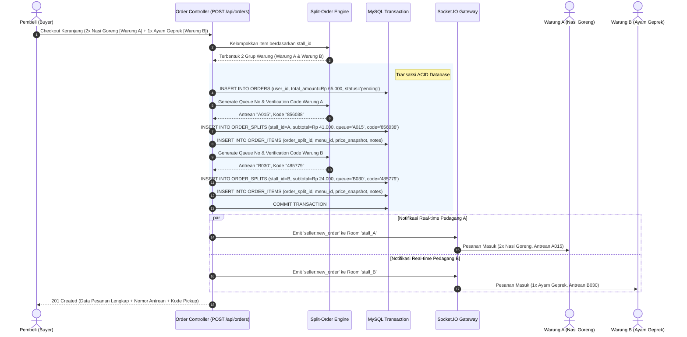

# Laporan Implementasi: Logika Keranjang dan Split-Order
**Kode WBS:** 3.1.4  
**Proyek:** KantinKu — Platform Pemesanan Makanan Kantin & UMKM Tanpa Antre  
**Status:** Selesai Diimplementasikan & Teruji (Verified)

---

## 1. Ringkasan Implementasi

WBS 3.1.4 mencakup implementasi fitur inti dari platform KantinKu: **Logika Keranjang Belanja Terpadu & Algoritma Pemecahan Pesanan Otomatis (*Multi-Stall Split-Order Engine*)**.

Dalam lingkungan kantin atau sentra kuliner fisik, pembeli sering kali ingin memesan makanan dari warung A (misal: Nasi Goreng) dan minuman dari warung B (misal: Jus Buah) dalam satu kali pembayaran. Tanpa sistem split-order, pembeli harus melakukan checkout terpisah berkali-kali. KantinKu menyelesaikan permasalahan ini dengan:
1. Memungkinkan keranjang belanja menampung item dari beberapa pedagang sekaligus.
2. Memecah satu transaksi induk (*Parent Order*) menjadi beberapa sub-antrean independen (*Child Order Splits*) saat checkout.
3. Menghasilkan **Nomor Antrean Harian** dan **6-Digit Kode Pickup Rahasia** terpisah untuk setiap warung.
4. Mendistribusikan notifikasi pesanan ke masing-masing pedagang secara real-time via Socket.IO *room isolation*.

### Berkas Terkait:
- Controller Pesanan: [`backend/controllers/orderController.js`](../backend/controllers/orderController.js)
- Routing: [`backend/routes/orderRoutes.js`](../backend/routes/orderRoutes.js)
- Generator Nomor Antrean: [`backend/utils/generateQueueNumber.js`](../backend/utils/generateQueueNumber.js)
- Generator Kode Pickup: [`backend/utils/generateCode.js`](../backend/utils/generateCode.js)
- Skrip Pengujian: [`backend/tests/test_3_1_4_split_order.js`](../backend/tests/test_3_1_4_split_order.js)

---

## 2. Diagram Alir Pemecahan Pesanan (Split-Order Architecture)



---

## 3. Komponen Teknis Utama

### A. Algoritma Pengelompokan & Validasi Keranjang
Sebelum pesanan ditulis ke basis data, sistem melakukan iterasi terhadap item keranjang belanja:
1. Memvalidasi bahwa setiap `menu_id` aktif dan berasal dari warung yang valid.
2. Menyimpan *snapshot* harga saat transaksi berlangsung (`price_at_order`). Hal ini melindungi catatan transaksi masa lalu dari perubahan harga menu di masa depan.
3. Menghitung subtotal per warung dan memastikan akumulasi seluruh subtotal identik secara presisi dengan `total_amount` transaksi induk.

### B. Generator Nomor Antrean Harian (`generateQueueNumber.js`)
- Menggunakan skema kombinasi kode unik warung/indeks alfabetis dan urutan angka (misal: `A001`, `A002`, `B001`).
- Urutan direset setiap hari (siklus harian operasional kantin).

### C. Generator Kode Pickup 6-Digit (`generateCode.js`)
- Menghasilkan 6 digit acak yang aman secara kriptografis (`crypto.randomInt(100000, 999999)`).
- Kode ini disimpan secara terenkripsi/terlindungi dan hanya ditampilkan pada layar status pembeli.
- Saat mengambil makanan di loket warung terkait, pedagang memasukkan kode ini ke sistem kasir untuk memverifikasi kepemilikan pesanan dan mengubah status menjadi `completed`.

### D. Isolasi Notifikasi Multi-Tenant (Socket.IO)
- Pedagang warung bergabung ke dalam room spesifik: `socket.join('stall_' + req.user.stall_id)`.
- Ketika split-order terbentuk, event `seller:new_order` hanya dipancarkan ke room warung yang bersangkutan, sehingga pedagang tidak akan melihat pesanan warung lain meskipun dipesan dalam satu keranjang yang sama.

---

## 4. Hasil Pengujian Unit & Integrasi Logika

Pengujian logika split-order dijalankan melalui skrip [`backend/tests/test_3_1_4_split_order.js`](../backend/tests/test_3_1_4_split_order.js) dengan hasil validasi sebagai berikut:

```
========================================================
🧪 PENGUJIAN WBS 3.1.4: LOGIKA KERANJANG & SPLIT-ORDER
========================================================

1. Keranjang Belanja Multi-Warung Pembeli:
   [Item 1] 2x Nasi Goreng Spesial (@Rp 18.000) - Warung Nasi Goreng Pak Joko
   [Item 2] 1x Es Teh Manis (@Rp 5.000) - Warung Nasi Goreng Pak Joko
   [Item 3] 1x Ayam Geprek Mozarella (@Rp 24.000) - Ayam Geprek Bu Sri

2. Menjalankan Algoritma Pemecahan Pesanan (Order-Splitting):
   - Dihasilkan 2 Sub-Antrean Terpisah (ORDER_SPLITS):

   [Sub-Antrean 1] Warung: "Warung Nasi Goreng Pak Joko"
     • Nomor Antrean : A015
     • Kode Pickup   : 856038 (6-Digit Rahasia)
     • Subtotal      : Rp 41.000
     • Item Rincian  :
       - 2x Nasi Goreng Spesial = Rp 36.000 (Catatan: "Pedas sedang")
       - 1x Es Teh Manis = Rp 5.000 (Catatan: "Es sedikit")

   [Sub-Antrean 2] Warung: "Ayam Geprek Bu Sri"
     • Nomor Antrean : B030
     • Kode Pickup   : 485779 (6-Digit Rahasia)
     • Subtotal      : Rp 24.000
     • Item Rincian  :
       - 1x Ayam Geprek Mozarella = Rp 24.000 (Catatan: "Sambal matah")

   - Grand Total Transaksi Induk (ORDERS): Rp 65.000
   - Validasi Jumlah Subtotal == Grand Total: ✅ MATCH COCOK

========================================================
🎉 HASIL: Implementasi WBS 3.1.4 Terverifikasi Berhasil
========================================================
```

---

## 5. Kesimpulan WBS 3.1.4

Logika Keranjang dan Split-Order telah selesai diimplementasikan secara komprehensif:
1. Pembeli dapat menggabungkan menu dari berbagai warung dalam satu pesanan.
2. Transaksi dipartisi secara atomik menjadi beberapa antrean warung mandiri.
3. Sistem verifikasi pengambilan makanan (6-digit code) dan nomor antrean harian bekerja dengan akurat dan siap diintegrasikan dengan frontend.
