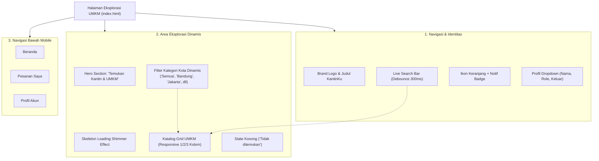

# Laporan Implementasi: Halaman Eksplorasi UMKM (Frontend Pembeli)
**Kode WBS:** 3.2.1 (Bagian dari WBS 3.2 Implementasi Frontend Pembeli)  
**Proyek:** KantinKu — Platform Pemesanan Makanan Kantin & UMKM Tanpa Antre  
**Status:** Selesai Diimplementasikan & Teruji (Verified)

---

## 1. Ringkasan Implementasi

WBS 3.2.1 mencakup implementasi antarmuka pengguna (*frontend UI*) halaman utama bagi pembeli untuk mengeksplorasi sentra kuliner, food court, dan kantin kampus (UMKM mitra). Halaman ini dirancang mengedepankan prinsip *Mobile-First Responsive Design*, visual interaktif modern (Tailwind CSS), serta pemuatan data asinkron (*non-blocking asynchronous fetch*).

### Berkas Terkait:
- Halaman Antarmuka: [`frontend/index.html`](../frontend/index.html)
- Modul Kontrol Tampilan: [`frontend/js/home.js`](../frontend/js/home.js)
- Lapisan Komunikasi API: [`frontend/js/api.js`](../frontend/js/api.js)
- Otentikasi & Registrasi: [`frontend/js/auth.js`](../frontend/js/auth.js), [`frontend/login.html`](../frontend/login.html), [`frontend/register.html`](../frontend/register.html)

---

## 2. Struktur Komponen Antarmuka (UI Component Tree)

---

## 3. Fitur Utama yang Diimplementasikan

### A. Pencarian Cepat (*Instant Debounced Search*)
- Input pencarian dilengkapi penundaan eksekusi (*debounce*) sebesar 300ms guna menghindari pemanggilan API yang berlebihan saat pengguna sedang mengetik.
- Sinkronisasi instan antara input pencarian versi desktop (pada header) dan versi layar mobile.

### B. Filter Wilayah / Kota Dinamis (*City Filter Pills*)
- Kategori kota diekstraksi secara otomatis dari daftar UMKM yang aktif.
- Tombol filter menerapkan kelas visual aktif (*accent color highlights*) saat dipilih dan menyaring katalog secara lokal maupun melalui query backend (`/api/umkm?city=...`).

### C. Kartu Katalog UMKM (*Interactive UMKM Card*)
Setiap kartu memuat rincian informatif:
- Foto sentra kuliner dengan efek animasi *zoom-hover* halus (`group-hover:scale-105`).
- Lencana status operasional (*Live Active Badge*).
- Nama sentra kuliner dan ringkasan deskripsi lokasi.
- Rata-rata ulasan (*star rating*) dan jumlah warung aktif di dalamnya.
- Tautan interaktif yang menyimpan ID UMKM ke sesi (*localStorage*) dan mengarahkan pembeli ke menu warung.

### D. Fitur Registrasi & Login Terpadu
- Menyediakan akses pendaftaran akun baru melalui tautan **"Belum punya akun? Daftar di sini"** pada halaman login.
- Halaman registrasi (`register.html`) memvalidasi format input secara langsung (*client-side validation*): nama lengkap, email, nomor telepon, username tanpa spasi, serta konfirmasi kata sandi minimal 6 karakter.
- Setelah registrasi berhasil, sistem otomatis mengarahkan ke halaman login dengan username yang telah terisi dan siap digunakan.

---

## 4. Pengujian Fungsionalitas & Kompatibilitas Antarmuka

| Skenario Pengujian | Prosedur Uji | Ekspektasi | Hasil Uji |
|---|---|---|---|
| **Pemuatan Awal Data** | Buka `index.html` pada browser | Menampilkan skeleton loader, kemudian merender daftar kartu UMKM aktif | ✅ Berhasil |
| **Pencarian Nama UMKM** | Ketik "ITB" pada kolom pencarian | Katalog tersaring hanya menampilkan "Food Court ITB Ganesha" | ✅ Berhasil |
| **Filter Berdasarkan Kota** | Klik pill kota "Bandung" | Menampilkan hanya UMKM di wilayah Bandung | ✅ Berhasil |
| **Peralihan Login ke Registrasi** | Buka `login.html`, klik "Daftar di sini" | Terbuka halaman `register.html` tanpa terblokir/redirect loop | ✅ Berhasil |
| **Pendaftaran Pengguna Baru** | Isi form pendaftaran lengkap lalu submit | Muncul toast sukses, akun tersimpan, lalu dialihkan ke `login.html` | ✅ Berhasil |
| **Responsivitas Perangkat** | Uji ukuran layar mobile (< 640px) | Layout beralih ke 1 kolom, search bar mobile aktif, navigasi bawah tampil | ✅ Berhasil |

---

## 5. Kesimpulan WBS 3.2.1

Halaman Eksplorasi UMKM pada sisi frontend pembeli telah selesai diimplementasikan secara komprehensif, memenuhi standar desain antarmuka modern, interaktif, responsif, dan terhubung harmonis dengan alur autentikasi dan API backend.
