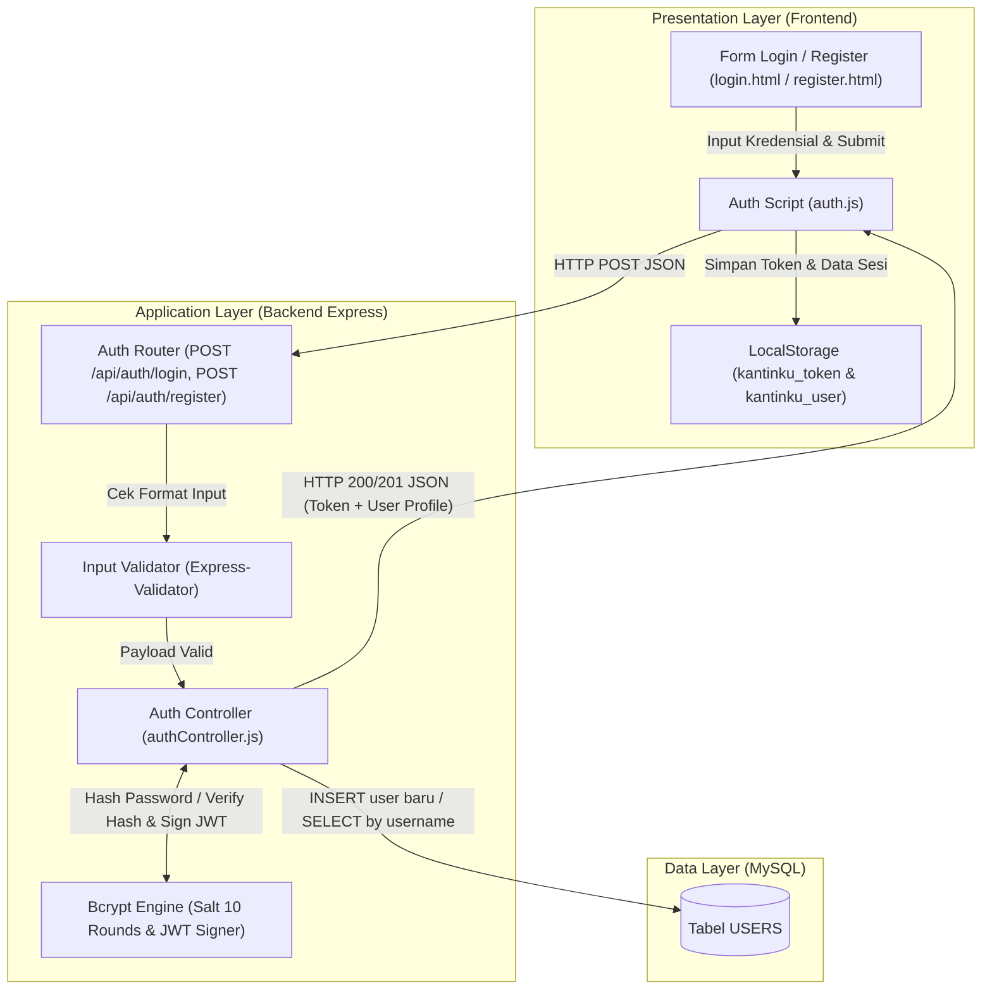
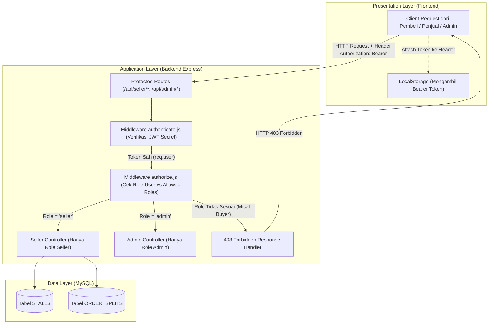
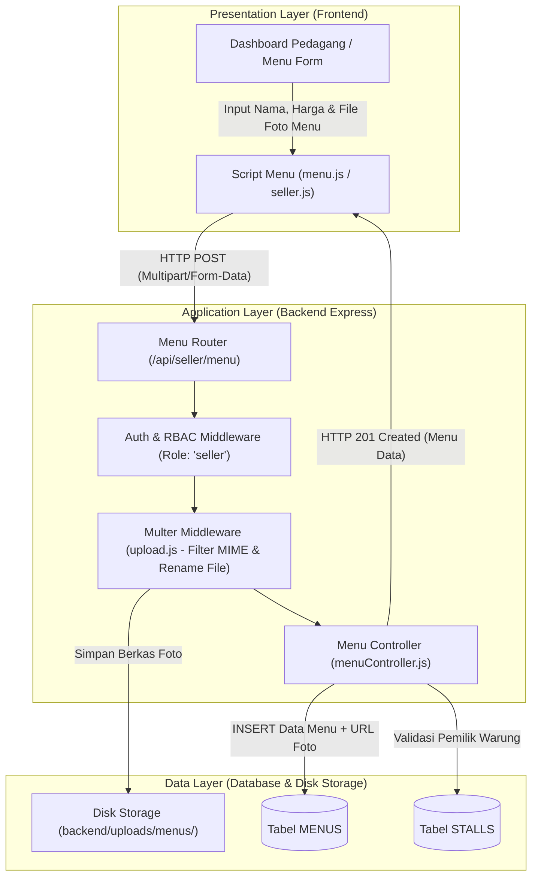
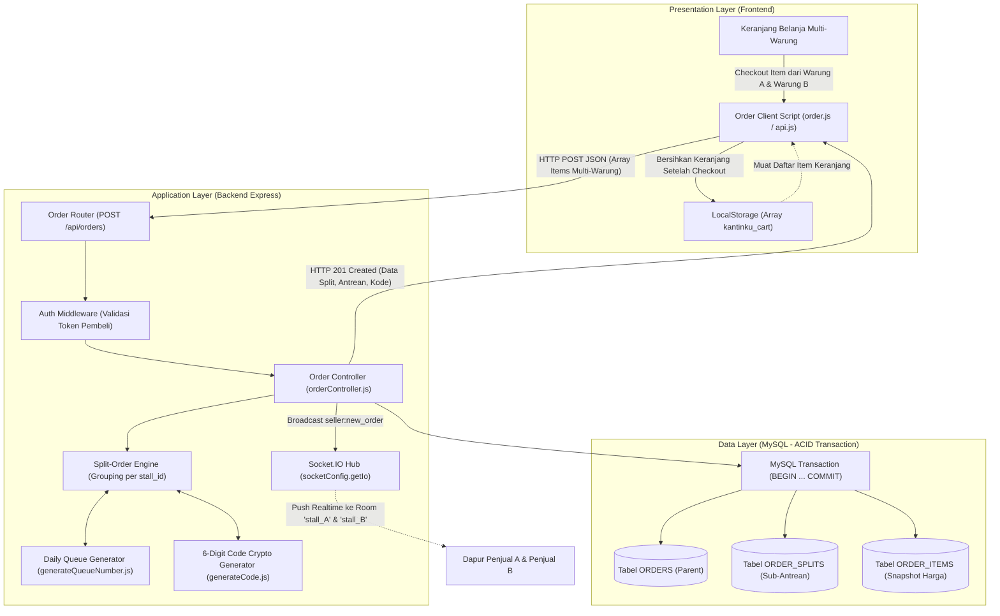
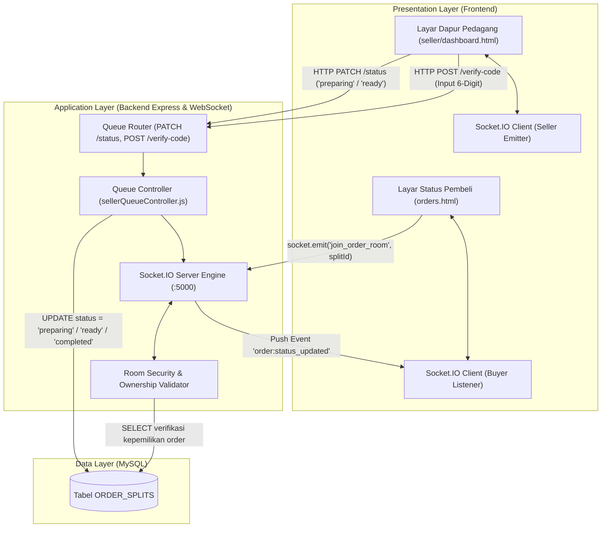
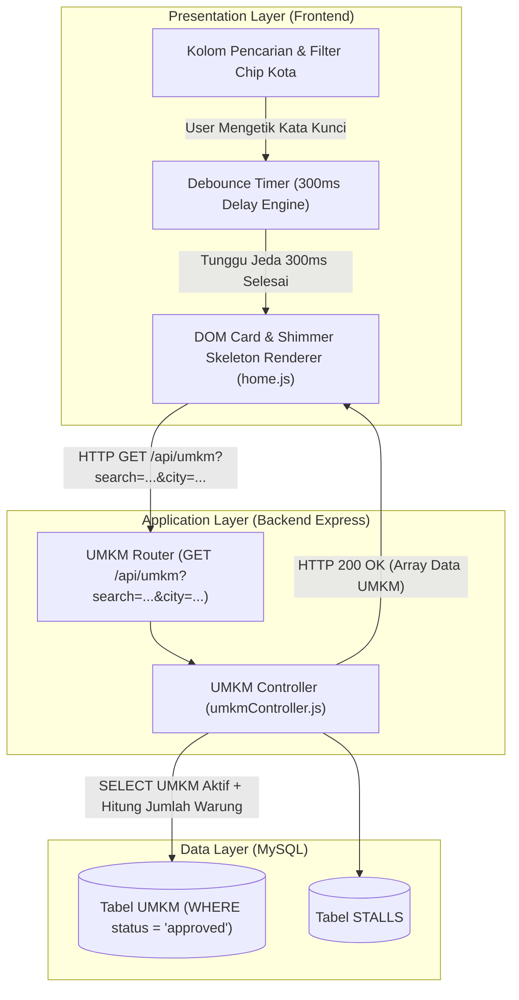

# DOKUMEN ALUR KERJA SISTEM & ARSITEKTUR TIGA LAPIS (THREE-TIER WORKFLOW)
## PLATFORM DIGITALISASI KANTIN & UMKM KAMPUS "KANTINKU"

---

Dokumen ini memuat perancangan dan penjelasan rinci mengenai arsitektur tiga lapis (*Presentation Layer*, *Application Layer*, dan *Data Layer*) serta alur kerja (*step-by-step workflow*) dari setiap fitur inti pada sistem **KantinKu**.

---

## DAFTAR ISI FITUR
1. [Fitur 1: Autentikasi Pengguna & Sesi JWT (Register & Login)](#1-fitur-autentikasi-pengguna--sesi-jwt-register--login)
2. [Fitur 2: Gerbang Otorisasi Role-Based Access Control (RBAC)](#2-fitur-gerbang-otorisasi-role-based-access-control-rbac)
3. [Fitur 3: Manajemen Katalog UMKM, Warung, dan Menu Makanan](#3-fitur-manajemen-katalog-umkm-warung-dan-menu-makanan)
4. [Fitur 4: Keranjang Terpadu & Algoritma Split-Order Multi-Warung](#4-fitur-keranjang-terpadu--algoritma-split-order-multi-warung)
5. [Fitur 5: Pelacakan Status Antrean Real-Time (Socket.IO) & Verifikasi Kode Pickup](#5-fitur-pelacakan-status-antrean-real-time-socketio--verifikasi-kode-pickup)
6. [Fitur 6: Eksplorasi Sentra Kuliner UMKM & Pencarian Instan (Frontend Client)](#6-fitur-eksplorasi-sentra-kuliner-umkm--pencarian-instan-frontend-client)

---

## 1. FITUR AUTENTIKASI PENGGUNA & SESI JWT (REGISTER & LOGIN)

### A. Diagram Arsitektur Tiga Lapis

### B. Penjelasan Langkah-demi-Langkah (Step-by-Step Flow)
1. **Input Pengguna (Presentation Layer):**
   - Pengguna memasukkan data pada formulir `login.html` atau `register.html`.
   - Skrip `auth.js` mengeksekusi validasi awal di sisi peramban: memastikan nama tidak kosong, username tidak memuat spasi, password minimal 6 karakter, dan konfirmasi password cocok.
2. **Pengiriman Permintaan (Client Request):**
   - Klien mengirim permintaan HTTP `POST` berformat JSON ke endpoint `/api/auth/login` atau `/api/auth/register`.
3. **Pemrosesan di Sisi Server (Application Layer):**
   - `authRoutes.js` menyalurkan request melalui middleware validator.
   - Pada pendaftaran: `authController.js` memanggil pustaka **Bcrypt** untuk menghasilkan hash acak dengan faktor salt 10 putaran, lalu menyimpan rekaman baru ke basis data dengan peran bawaan `buyer`.
   - Pada login: `authController.js` mengambil data pengguna dari basis data, membandingkan hash password via `bcrypt.compare()`, dan jika valid, menandatangani token **JSON Web Token (JWT)** berstandar RFC 7519 menggunakan kunci rahasia server.
4. **Respon & Penyimpanan Sesi (Data & Client Layer):**
   - Server mengembalikan respon HTTP `200 OK` (Login) atau `201 Created` (Register) beserta token JWT.
   - `auth.js` menyimpan token tersebut ke `localStorage.setItem('kantinku_token', token)` agar sesi pengguna tetap aktif di semua halaman berikutnya tanpa perlu login ulang.

---

## 2. FITUR GERBANG OTORISASI ROLE-BASED ACCESS CONTROL (RBAC)

### A. Diagram Arsitektur Tiga Lapis

### B. Penjelasan Langkah-demi-Langkah (Step-by-Step Flow)
1. **Penyertaan Token Akses (Presentation Layer):**
   - Pengguna melakukan request ke endpoint privat (misal: halaman antrean dapur `/api/seller/queue`).
   - Lapisan HTTP klien (`api.js`) secara otomatis menyisipkan token dari LocalStorage ke dalam header request: `Authorization: Bearer <token_jwt>`.
2. **Pemeriksaan Keabsahan Identitas (Middleware Autentikasi):**
   - Middleware `authenticate.js` mencegat request dan memverifikasi tanda tangan digital token menggunakan `jwt.verify(token, process.env.JWT_SECRET)`.
   - Jika token tidak ditemukan atau rusak, server langsung merespons **HTTP 401 Unauthorized**.
   - Jika token sah, payload data (`id`, `username`, `role`) ditempelkan ke objek request sistem (`req.user = decoded`).
3. **Penyaringan Hak Akses Berbasis Peran (Middleware Otorisasi):**
   - Middleware `authorize(['seller'])` mengevaluasi atribut `req.user.role`.
   - **Kasus Pelanggaran Hak Akses:** Jika pengguna berstatus `buyer` mencoba mengakses endpoint pedagang, middleware memutus alur dan melempar respons **HTTP 403 Forbidden** (`"Forbidden. You do not have permission to access this resource."`). Controller sensitif sama sekali tidak dieksekusi.
   - **Kasus Sesuai Hak Akses:** Jika `role === 'seller'`, middleware memanggil `next()` untuk melanjutkan proses ke fungsi controller yang dituju.

---

## 3. FITUR MANAJEMEN KATALOG UMKM, WARUNG, DAN MENU MAKANAN

### A. Diagram Arsitektur Tiga Lapis

### B. Penjelasan Langkah-demi-Langkah (Step-by-Step Flow)
1. **Pengisian Data Produk (Presentation Layer):**
   - Pedagang memasukkan rincian item (nama makanan, deskripsi, harga, kategori) serta mengunggah foto produk melalui formulir di `seller/dashboard.html`.
2. **Pengiriman Berkas Multipart:**
   - Klien mengirimkan payload sebagai `FormData` (multipart/form-data) via HTTP `POST` ke `/api/seller/menu`.
3. **Penyaringan & Sanitasi Berkas (Application Layer):**
   - Middleware RBAC mengonfirmasi hak pedagang.
   - Middleware `upload.js` (Multer) memeriksa berkas: menyaring tipe MIME gambar (`jpeg`, `png`, `webp`), membatasi ukuran maksimal 2MB, menghasilkan nama berkas acak aman berbasis timestamp (`menu-[timestamp]-[random].ext`), dan menyimpannya secara fisik ke direktori `/uploads/menus/`.
4. **Pencatatan Entitas Basis Data (Data Layer):**
   - `menuController.js` memvalidasi bahwa warung terkait benar-benar milik pedagang tersebut (`owner_id = req.user.id`).
   - Menyimpan rekaman menu baru beserta path URL gambar ke **Tabel MENUS**.
   - Server mengembalikan status HTTP `201 Created`, dan antarmuka pedagang memperbarui tabel menu secara seketika.

---

## 4. FITUR KERANJANG TERPADU & ALGORITMA SPLIT-ORDER MULTI-WARUNG

### A. Diagram Arsitektur Tiga Lapis

### B. Penjelasan Langkah-demi-Langkah (Step-by-Step Flow)
1. **Penggabungan Keranjang Heterogen (Presentation Layer):**
   - Pembeli memilih menu dari beberapa gerai berbeda (misal: Nasi Goreng dari Warung A dan Jus Jeruk dari Warung B) ke dalam satu keranjang belanja.
   - Pembeli menekan tombol Checkout dan memilih metode pemesanan (*dine-in / takeaway*).
2. **Pengelompokan Otomatis (Application Layer - Split-Order Engine):**
   - `orderController.js` menerima payload array item dan melakukan pengelompokan linier $\mathcal{O}(N)$ berdasarkan atribut `stall_id`.
3. **Integritas Transaksi ACID (Data Layer):**
   - Server menginisiasi transaksi database: `await connection.beginTransaction()`.
   - Mengambil data harga resmi dari tabel `MENU_ITEMS` dan mencatatnya sebagai `price_at_order` (snapshot harga proteksi inflasi).
   - Menghitung grand total transaksi induk dan menyimpannya ke **Tabel ORDERS**.
   - Untuk setiap warung yang terlibat:
     - Menghasilkan nomor antrean harian mandiri via `generateQueueNumber()` (misal `A015` dan `B030`).
     - Menghasilkan 6-digit kode verifikasi pengambilan rahasia via `crypto.randomInt(100000, 999999)` (misal `856038`).
     - Menyimpan record sub-antrean ke **Tabel ORDER_SPLITS** dan rincian makanannya ke **Tabel ORDER_ITEMS**.
   - Transaksi dikukuhkan: `await connection.commit()`.
4. **Diseminasi Notifikasi Real-Time (Socket.IO):**
   - Server memancarkan event `seller:new_order` secara paralel hanya ke kamar warung masing-masing (`stall_stl-01` dan `stall_stl-02`). Dapur warung lain tidak menerima data tersebut.
5. **Konfirmasi Selesai:** Pembeli menerima respon HTTP `201 Created` berisi rincian pesanan, nomor antrean, dan kode pickup, sedangkan keranjang belanja lokal dibersihkan.

---

## 5. FITUR PELACAKAN STATUS ANTREAN REAL-TIME (SOCKET.IO) & VERIFIKASI KODE PICKUP

### A. Diagram Arsitektur Tiga Lapis

### B. Penjelasan Langkah-demi-Langkah (Step-by-Step Flow)
1. **Inisiasi Saluran WebSocket & Langganan Kamar (Subscription):**
   - Pembeli membuka layar status pesanan (`orders.html`). Skrip socket mengirimkan permintaan bergabung: `socket.emit('join_order_room', splitId)`.
   - Modul `RoomSecurity` di backend mengecek ke basis data: memvalidasi bahwa `socket.user.id` memang merupakan pembeli yang memiliki `splitId` tersebut. Jika terbukti sah, socket bergabung ke ruang `order_${splitId}`.
2. **Pembaruan Status Memasak Dapur (Status Transition):**
   - Pedagang menekan tombol *"Mulai Masak"* di dapur. Klien pedagang mengirimkan permintaan HTTP `PATCH /api/seller/queue/:splitId/status` dengan payload `{ status: "preparing" }`.
   - `sellerQueueController.js` memperbarui kolom `status` di tabel `ORDER_SPLITS`.
   - Server memancarkan sinyal ke ruang pemesan: `io.to('order_' + splitId).emit('order:status_updated', { status: 'preparing' })`.
   - Tanpa me-refresh halaman, kartu pesanan pada gawai pembeli berubah warna menjadi kuning dengan keterangan *"Sedang Dimasak 🍳"*.
3. **Pemberitahuan Makanan Siap Diambil:**
   - Ketika masakan selesai, pedagang menekan tombol *"Siap Diambil"* (`status = "ready"`).
   - Pembeli menerima notifikasi seketika dan layar gawai menampilkan **6-Digit Kode Verifikasi Pengambilan Rahasia**.
4. **Verifikasi Pengambilan di Loket (Pickup Handoff):**
   - Pembeli mendatangi loket gerai dan menyebutkan nomor antrean serta menunjukkan 6-digit kode verifikasi.
   - Pedagang mengetik kode tersebut ke form loket kasir (`POST /api/seller/queue/:splitId/verify-code`).
   - Server membandingkan kode masukan dengan data tersimpan: jika cocok, status diubah menjadi `"completed"`, event push WebSocket dikirimkan ke pembeli, dan pesanan selesai secara sah.

---

## 6. FITUR EKSPLORASI SENTRA KULINER UMKM & PENCARIAN INSTAN (FRONTEND CLIENT)

### A. Diagram Arsitektur Tiga Lapis

### B. Penjelasan Langkah-demi-Langkah (Step-by-Step Flow)
1. **Interaksi Pengguna (Presentation Layer):**
   - Pembeli mengetikkan nama kantin pada bilah pencarian atau mengklik salah satu tombol filter wilayah kota (`Bandung`, `Depok/Jakarta`, dll).
2. **Optimasi Debounce 300ms:**
   - Skrip `home.js` mengaktifkan mekanisme *timer debounce*. Panggilan jaringan ke server ditahan selama 300 milidetik.
   - Jika pengguna masih terus menekan tombol huruf berikutnya, timer sebelumnya dibatalkan (*cleared*) dan diulang kembali. Hal ini mencegah pengiriman request berlebihan (*zero over-fetching*).
3. **Pemuatan Visual Sementara (Skeleton Loading):**
   - Selama permintaan data berjalan, kontainer UI menampilkan animasi *shimmer skeleton loader* untuk memberikan indikator visual yang nyaman kepada pengguna.
4. **Penyaringan Database (Application & Data Layer):**
   - Permintaan HTTP `GET /api/umkm?search=...&city=...` diterima oleh `umkmController.js`.
   - Query SQL menyaring sentra kuliner yang hanya berstatus `approved` dan mencocokkan kata kunci pencarian.
5. **Rendering Kartu Interaktif:**
   - Hasil JSON dipetakan ke dalam elemen DOM kartu UMKM, menampilkan foto gerai, lencana status buka toko, jumlah warung aktif, serta rating ulasan bintang.
